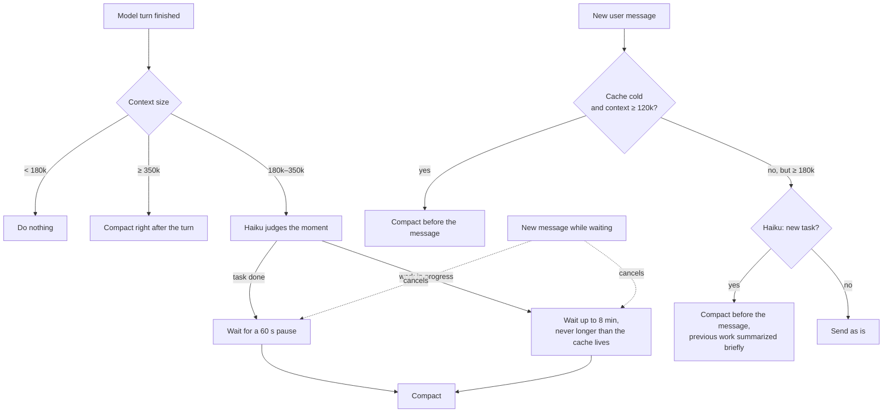

# smart-compact

A Claude Code plugin that compacts your session's context **at the most cost-effective moment** — when it is cheapest and gets in the way the least.

It watches the context size after every turn, knows whether the prompt cache is still warm, and uses **Claude Haiku 5.5** as a cheap helper to judge task boundaries, detect topic switches, and list what must survive the compaction.

- [Why](#why)
- [How it works](#how-it-works)
- [Installation](#installation)
- [Usage](#usage)
- [Configuration](#configuration)
- [FAQ](#faq)
- [Troubleshooting](#troubleshooting)
- [Limitations](#limitations)

## Why

Every step the model takes — every message, every tool call — sends the **entire conversation history** again. At 300k tokens of context, each step costs 300k input tokens. Compacting to ~30k makes every following step roughly **10× cheaper** and keeps the model focused.

On 1M-context models, Claude Code's built-in auto-compaction only kicks in near the very end of the window, so a session can grow to hundreds of thousands of tokens with every step paying full length. On the other hand, compaction is lossy: done at the wrong moment (in the middle of debugging, right before the user answers a question) it throws away exactly the details that are needed next.

smart-compact picks the moment.

## How it works



### The rules

| Situation | What happens |
|---|---|
| Context below **180k** | Nothing. You won't notice the plugin. |
| Context **≥ 350k** | Compacts right after the turn ends. |
| **180k–350k**, Haiku says the task is **done** | Compacts after a 60-second pause. |
| **180k–350k**, Haiku says work is **in progress** (debugging, a question to you, awaiting confirmation) | Compacts only after a long pause (8 min), and never later than the cache's lifetime. |
| You send a message after a break, the **cache is cold** and context **≥ 120k** | Compacts **before** your message. |
| You send a message at **≥ 180k** and Haiku sees a **new, unrelated task** | Compacts before your message; the previous work is summarized briefly. |
| You send a message while a compaction is pending | The pending compaction is cancelled and reassessed after the turn. |

On models with a 200k window the thresholds are lowered automatically (80% of the window and below), so the plugin acts before the built-in auto-compaction.

### Why the cache matters

Reading the history from a **warm** prompt cache costs about **10× less** than regular input. A compaction itself reads the whole history once, so:

- while the cache is **warm**, compaction is cheap — every wait is capped by the cache lifetime so the compaction still hits the cache;
- once the cache is **cold**, your next message would re-read the whole history at full price anyway — so it is better to compact first and pay that price once, then continue with a short context.

### How the cache lifetime is learned

The prompt cache lives either 5 minutes or 1 hour, depending on your setup. After every pause longer than 5 minutes, the plugin looks at the first turn's usage: was the history **read from the cache** (`cache_read_input_tokens`) or **written anew** (`cache_creation_input_tokens`)? Read → the cache lives an hour; written → 5 minutes. The result is remembered across sessions. Until it is known, the plugin assumes 5 minutes (the safe choice). You can also set it explicitly with `cacheTtl`.

### What the helper (Haiku) does

| Call | Effort | When |
|---|---|---|
| Is the task done or in progress? | low | After each turn, only when context ≥ 180k |
| Is the new message a new task? | low | Before your message, only when context ≥ 180k |
| What must survive the compaction? | medium | Right before every compaction |

The last call produces a bulleted list — file paths, exact error messages, commands, values, decisions, your explicit requests, unfinished steps — which is appended to the compaction instructions. Haiku calls cost a few thousand tokens each — a fraction of a percent of one step of the main model at 200k context. Set `helperModel` to an empty string to turn the helper off; the plugin then falls back to pause-based rules.

### What you see

- A status line when the context is large: `ctx 210k · cache warm ~3 min · compact in 2 min`
- A notification after each compaction: `task done, 210k: 210k → 25k; read from cache 205k, written 8k`
- `/smart-compact` — the full status (see [Usage](#usage)).

## Installation

**Requirements:** Claude Code with function-hook plugin modules (tested on 2.1.29x). Works in the Code tab of the Claude desktop app and in the terminal `claude`.

### From GitHub (recommended)

```bash
claude plugin marketplace add mdseyam-as/claude-smart-compact
```

```bash
claude plugin install smart-compact@smart-compact --scope user
```

`--scope user` enables it in every project. Use `--scope project` to enable it for the current project only.

Or, inside Claude Code: `/plugin` → **Add marketplace** → `mdseyam-as/claude-smart-compact` → install **smart-compact**.

The plugin loads in **new** sessions. Sessions that were already open need to be restarted (or try `/reload-plugins`).

### From a local folder

```bash
git clone https://github.com/mdseyam-as/claude-smart-compact
```

```bash
claude plugin marketplace add ./claude-smart-compact
```

```bash
claude plugin install smart-compact@smart-compact --scope user
```

A plugin installed from a local folder is read from that folder directly: edit it and run `/reload-plugins` to pick up changes.

### Verify

Start a new Claude Code session and run:

```
/smart-compact
```

You should see the context size, thresholds and cache state.

### Update

```bash
claude plugin marketplace update smart-compact
```

```bash
claude plugin update smart-compact@smart-compact
```

### Uninstall

```bash
claude plugin uninstall smart-compact@smart-compact
```

## Usage

Nothing to do — the plugin works by itself in every session. Optional commands:

| Command | What it does |
|---|---|
| `/smart-compact` | Status: context size, thresholds, cache lifetime and state, last assessment, last compaction, pending compaction |
| `/smart-compact now` | Compact now (Haiku still prepares the keep-list) |
| `/smart-compact off` | Cancel the pending compaction until the next turn |

Example status:

```
context 212k of 1000k
thresholds: assess 180k, hard 350k, cold cache 120k
cache: lives 60 min (learned), now warm for ~41 more min
pauses: 60 s after a finished task, 8 min mid-work
helper claude-haiku-5-5, topic switch on
last assessment: task done at 212k; last compaction: none yet
pending: compaction in 1 min
```

## Configuration

All options are optional; defaults apply until you change them.

| Option | Default | What it does |
|---|---|---|
| `softTokens` | `180000` | From this size Haiku judges the moment after each turn |
| `hardTokens` | `350000` | From this size compact right after the turn |
| `coldTokens` | `120000` | With a cold cache, compact before the next message from this size |
| `idleMinutes` | `8` | Pause before compacting mid-work (capped by the cache lifetime) |
| `doneIdleSeconds` | `60` | Pause before compacting after a finished task |
| `helperModel` | `claude-haiku-5-5` | Helper model; empty string disables the helper |
| `topicCheck` | `true` | Compact before a message that starts a new task |
| `cacheTtl` | `auto` | `auto` (learn from cache hits), `5m` or `1h` |

### Ways to change them

**1. Interactive form** — in the terminal `claude`:

```
/plugin configure smart-compact@smart-compact
```

**2. Command line** — show the current options:

```bash
claude plugin configure smart-compact@smart-compact
```

and set values (a JSON object of strings; options left out keep their values):

```bash
echo '{"softTokens":"120000","hardTokens":"250000"}' | claude plugin configure smart-compact@smart-compact --values-stdin
```

Options can also be given at install time: `claude plugin install smart-compact@smart-compact --scope user --config softTokens=120000`.

**3. `~/.claude/settings.json`:**

```json
{
  "pluginConfigs": {
    "smart-compact@smart-compact": {
      "options": {
        "softTokens": 120000,
        "hardTokens": 250000,
        "idleMinutes": 10
      }
    }
  }
}
```

Changes made through the form reload the plugin immediately; edits to `settings.json` apply to new sessions.

### Presets

| Goal | `softTokens` | `hardTokens` | `idleMinutes` |
|---|---|---|---|
| Quality (default) — compact rarely, keep details | 180000 | 350000 | 8 |
| Economy — cheaper steps, more frequent compaction | 120000 | 250000 | 5 |
| Hard threshold only, no helper | 900000 | 350000 | 8 (plus `helperModel` = `""`, `topicCheck` = `false`) |

## FAQ

**Does it replace Claude Code's built-in auto-compaction?**
No. Built-in auto-compaction still runs near the end of the window as a safety net. smart-compact just compacts earlier, at a better moment.

**Does it save usage limits on a subscription?**
In long sessions, yes: each step after a compaction sends far fewer tokens. In short sessions (under 180k) it does nothing and costs nothing.

**Can it compact at a bad moment?**
Haiku's judgment is a heuristic, so sometimes a compaction happens slightly earlier or later than ideal. The plugin never compacts while a turn is running, cancels a pending compaction as soon as you send a message, and asks Haiku to preserve concrete details before every compaction. Long-lived agreements are best kept in `CLAUDE.md`, which is reloaded after every compaction.

**Does it work in the regular Claude chat?**
No — only in Claude Code (the Code tab of the desktop app and the terminal `claude`).

**Is anything sent anywhere?**
Only the usual model calls through your own Claude Code session (Haiku goes through the session's own client). The only value the plugin persists is the learned cache lifetime, kept in Claude Code's local plugin store.

## Troubleshooting

| Problem | Fix |
|---|---|
| `/smart-compact` is not found | The session was started before installation — open a new session (or try `/reload-plugins`). Check `claude plugin list`. |
| It never compacts | Context is probably below 180k — check `/smart-compact`. Lower `softTokens` if you want earlier compaction. |
| It compacts too often | Raise `softTokens` / `hardTokens`, or increase `idleMinutes`. |
| A notification says "skipped" | Another plugin or a `PreCompact` settings hook vetoed the compaction; the reason is in the notification. |
| Debugging | Run `claude --debug` and search the log for `smart-compact`. |

## Limitations

- Claude Code only; requires support for plugin hook modules.
- Haiku's assessment is a heuristic.
- If Claude Code does not allow compaction at the moment a message is submitted, the plugin lets the message through and reassesses after the turn.

## License

[MIT](LICENSE)
